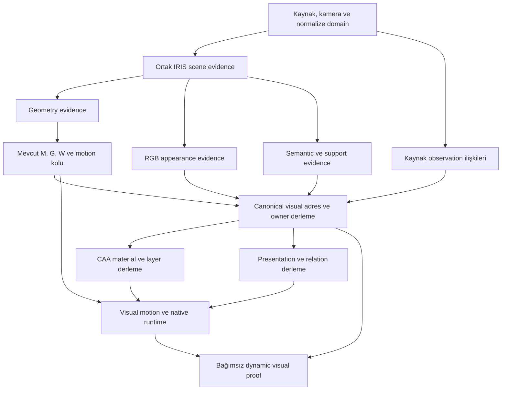

# IRIS: ortak geometri ve appearance evidence — onay bekleyen öneri

**Tarih:** 11 Ekim 2026
**Kod inceleme tabanı:** `main@66b8b4baf565a187d9841a723b8035754a4ec746`; canlı main ref’i ayrıca doğrulandı.
**Onay durumu:** ÖNERİ — KULLANICI HENÜZ ONAYLAMADI. Uygulanacak next step değildir. Aşağıdaki karar/akış/faz ifadelerinin tamamı öneri kapsamındadır.

**Durum:** Tasarım ve araştırma planı. Yeni head, eğitim, EngineRelease, Attempt veya render bu belgeyle uygulanmış/çalıştırılmış sayılmaz.

## 1. Önerilen yön ve araştırma iddiası

Öneri, IRIS’in ortak sahne temsilinden **geometri, renk ve görsel sahiplik evidence’ının birlikte çıkarılmasıdır**. Compiler bunları aynı canonical adresleme üzerinden mekanik ve görüntü kollarına ayıracak. Böylece birbirinden bağımsız üretilmiş görsel parçaların sonradan mekanik yüzeye eşleştirilmesini azaltmayı hedefliyoruz.

Bu yön değişikliği değerlendirilmek üzere sunulan bir araştırma önerisidir. Mevcut işin uzun sürmesi tek başına önceki yöntemin imkânsızlığını veya yeni yöntemin başarısını kanıtlamaz. Elimizdeki somut gerekçe, mevcut temsilde görünüm sahipliği/örtülü destek eksikliği, gerçek tüketici kopuklukları ve destek adresleme problemlerinin birlikte görülmesidir.

**Hipotez:** Ortak sahne evidence’ı + korunmuş kaynak gözlemleri + açık owner/layer adresleri, ayrı görsel dünyalar arasındaki eşleştirme yükünü ve kayıp parça hatalarını azaltır. Aynı M/G/W, hareket ve tüketici koşullarında ölçülecek; otomatik başarı kabul edilmeyecek.

Eski görüntü hattının bütün açıklarını kapatmak bu araştırmanın önkoşulu değildir. Mevcut sonuçlar tanı tabanı olarak saklanır. Yeni temsilin kendi üretici–tüketici zinciri ve bağımsız kabul ölçümleri kurulmalıdır.

## 2. İncelenen mevcut yapının sınırı

| Mevcut sınır | Koddan / veriden doğrulanan durum | Yeni tasarımın karşılığı |
|---|---|---|
| IRIS sahne belleği | `models/iris/v4/scene_first_signed_v4.py`: `CameraAwareViewTokenBankV4` → `SharedTriplaneSceneFusionV4`; `encode_scene()` ortak planes üretir | Ayrı kimlikli, yeniden kullanılabilir scene evidence artifact’ı |
| Alan sorgusu | `ContinuousSignedSurfaceFieldV4.forward()` verilen 3D koordinatlarda `sdf` ve `log_uncertainty` döndürür | Aynı koordinat/scene sorgularına bağımsız RGB ve semantic evidence decoder’ları |
| Piksel–3D ilişkisi | Model API’si her kaynak piksel için kesin bir yüzey eşlemesi yayımlamıyor | Kamera, görünürlük, source footprint ve belirsizlik içeren explicit observation resolver |
| Son mekanik domain | Stage18/19 ve `surface_addressing_v1.py`; adresler candidate/topoloji/support kimliğine bağlı | Appearance evidence’ın son M’ye taşındığını kanıtlayan adres geçişi |
| Görsel domain | Stage18 kaynak siluetinden görsel mesh; Stage37 güvenli bölgeler ve presentation yapısı | Ortak evidence’tan türetilen owner/layer/fragment domain’i |
| CAA | Stage20–24 kaynak, provenance, completion ve bake/qualification sahibi | Yeni head evidence’ını kabul eden malzeme üreticisi; source wins korunur |
| Hareket tüketimi | Canonical Stage42 `bind_region_visual_vertices_to_mechanical_affine_v1` kullanır; arşiv V6 farklı operator kullanır | Tek typed visual-motion consumer; exact operator kimliği her sonuçta |
| Platform modülerliği | Go gerçek DAG/read-set/implementation değişikliklerini izler; bazı producer/import sınırları hâlâ geniş | Ayrı scene/head/geometry/material/owner çıktıları ve gerçek kaynak modül ayrımı |

Güncel Knight denetiminde sekiz raw source ile Stage23 texture’larının **1.347.911 foreground pikselinde RGBA kanal farkı 0**. Sorun yalnız rengin hiç üretilmemesi değildir. CAA örneklerinin mevcut M üzerindeki barycentric konum hatası en fazla **4.965e−16 mesh koordinatı**; bu renk/sahiplik/gizli katman doğruluğu değildir.

**69.280 face-sample kaydı** var. Bunların 48.808’i bütün yönlerde direct desteği olmayan kayıtlar. Bağımsız denetimde 18.093 kayıt için bir yönde point-front-depth ve source mask desteği bulundu; 14.367’sinde aynı canonical edge/vertex üzerindeki başka pixel-face owner etkisi var. Bunlar **eligibility adayıdır**, güvenilir renk veya ortak material owner kabulü değildir. Geometrik alias sayımı 31.643 farklı geometrik adres buldu; aynı konumda bulunmak görsel katmanların birleşmesini gerektirmez.

Bu CAA ledger’ında Stage28/32/35/36/37 ve sonraki aşamalar PENDING. Yeni canonical render yok. Stage24 hidden support/full visual qualification vermiyor; completion sidecar’ını okumak mevcut Stage42’de completion material transport olarak **0 örnek** tüketiyor. Bu durum yeni head gerekliliğinin tam consumer kapanışından sonra kanıtlandığı anlamına gelmez.

### 2.1. Son kullanıcı yönlendirmesi: mevcut mekanik sahipliği kullan

GSA/TESSA/topoloji/mekanik sahiplik sıfırdan kurulacak parçalar değildir. Mühürlü Knight kapsülündeki `qualified_rigging_surface.json` bağımsız okunup byte hash’i doğrulandı:

| Mevcut GSA kaydı | Sayı / kapsam |
|---|---|
| `SurfaceNode` | 12.090; son M’nin 3.653 vertex’i ile aynı domain değildir |
| `surface_id` / `persistence_group_id` taşıyan düğüm | 12.090 |
| `raster_bindings` taşıyan düğüm | 7.924 |
| `source_observation_ids` taşıyan düğüm | 0; scene-first producer bu listeyi boş bırakıyor |

Kodda `SurfaceNode` zaten source/provenance, view, raster, normal ve persistence alanlarını taşıyor. `scene_first_signed.py` bunları surface üretirken yayımlıyor; bu raster binding bir projection/self-zbuffer destek kaydıdır, pixel-perfect artist owner kabulü değildir. `mechanical_partition_v1.py` structural relation’lardan continuity/cut/unknown kararları çıkarıyor ve categorical identity kullandığını iddia etmiyor. `TESSAConditioningV1` 17 boyutlu XYZ/normal/view-support/degree/persistence özellikleri ile `surface_ids` ve `component_ids` taşıyor; RGB/artist layer descriptor bu tensorun içinde yok.

`tessa_surface_field_v1.py` ve `tessa_candidate_bridge_v1.py`, TESSA vertex’lerine GSA material-field support katsayıları ve component bağları taşıyor. Bu, yeni appearance evidence’ın downstream aktarımı için önemli bir mevcut bağlantıdır. **Material-support katsayısı geometrik konum eşitliği veya artist-layer sınırı garantisi değildir.** Semantic dağılım/descriptor bu bağ üzerinden aday olarak taşınabilir; seam/owner karışması ve residual ayrıca ölçülür.

Planın ilk tercihi: ortak IRIS features’a eklenen görünüm evidence’ı GSA node/query adreslerine bağlı kalsın; mevcut support/partition/topoloji zinciriyle son M’ye ulaşsın. Compiler ayrıca final M üzerinde aynı frozen IRIS field’ı sorgulayabilsin. Bu iki aktarımın uyuştuğu ve hangi bölgede uyuşmadığı ölçülür; yalnız nearest-XYZ eşleştirmesine dönülmez.

G/M/W’nin doğru hareket üretmesi bir deformasyon adresi ve sürekliliği konusunda güçlü kanıttır. Triangle flip/collapse bulunmaması tek başına anatomik/artist identity’nin bütün sınırlarını kanıtlamaz. Kıyafet ve alttaki gövde aynı W ile hareket edebilir; bir çizilebilir owner birkaç joint/component boyunca uzanabilir. **Mechanical region ↔ drawable owner ilişkisi many-to-many** olur. W benzerliği, ortak hareket, adjacency ve mevcut component sınırları görsel owner kararının evidence’ıdır; W argmax’ından otomatik semantic etiketi üretilmez.

IRIS’in erken semantic head’i yalnız görüntü/scene evidence’tan çalışır. GSA/TESSA/M/G/W’den gelen constraint’ler downstream Compiler’ın owner resolve/qualification aşamasında kullanılır. Upstream IRIS node’una downstream MIRA/W bağı eklenip DAG döngüsü yaratılmaz. Sonradan mekanik koşullu bir refinement modeli denenirse bu, ayrı downstream research node’u ve ayrı read-set olarak ilan edilir.

Mevcut teacher-relative Knight mekanik başarısı korunur. Yeni CAA ledger’ındaki Stage35 PENDING, bu eski scoped mekanik sonucu geri almaz; yeni canonical producer–consumer yürütümünün henüz yapılmadığını gösterir. Plan yeni bir rig/skin fit’i açmaz.

## 3. Temel temsil: ortak sahne, çoklu görsel sahiplik

Önerilen hesap:

\[
Z=E(I_{0:7},C_{0:7}),\qquad g(x)=D_g(Z,x)
\]

\[
a(x,v,\ell)=D_{rgb}(Z,x,v,\ell),\qquad s(x,v)=D_{sem}(Z,x,v)
\]

`Z` ortak scene evidence, `x` aynı normalize 3D sorgu adresi, `v` görünüm koşulu, `ℓ` aday görsel layer/owner koşuludur. `g` mevcut signed geometry evidence’ı; `a` RGBA/material önerisi ve güven; `s` semantic sınıf, instance/owner descriptor, sınır, affinity ve belirsizlik evidence’ıdır.

**Aynı scene/query kimliğini paylaşmak, aynı canonical owner olmak değildir.** Kıyafet, alttaki gövde, yüzey çizgisi ve ekipman aynı bölgeye yakın olabilir. Bunları yalnız XYZ yakınlığıyla birleştirmeyeceğiz. Model canonical kimlik atamaz; Compiler evidence’ı değerlendirip subject-local owner/fragment kimliklerini mühürler.

İki ana öğrenilmiş appearance çıkışı öneriyorum:

| Çıkış | İlk sürümde üreteceği evidence | Ne yerine geçmez? |
|---|---|---|
| RGB / appearance head | View/layer koşullu renk, alpha/material confidence; gözlenmeyen alan için aday completion | Gerçek source RGB’nin yerine geçmez; amodal domain yoksa renk tek başına domain oluşturmaz |
| Semantic / ownership head | Semantic olasılıklar, subject-local instance descriptor, same-owner affinity, boundary ve belirsizlik | Aynı sınıftaki iki el/ayak aynı owner değildir; bone weight en büyüğü owner truth değildir |
| Appearance yardımcı çıkışları | Visible/amodal support ve overlap evidence; gerektiğinde owner koşullu chart decoder | Statik order bütün hareketlerin order’ı değildir; bilinmeyen support “tamam” sayılmaz |

Bunlar iki büyük bağımsız görüntü modeli kurmak anlamına gelmez. İlk arm, frozen ortak temsilin üstünde küçük decoder’lar kullanır. Kapasite ve çözünürlük yetersiz çıkarsa yalnız appearance koluna yüksek çözünürlüklü RGBA/alpha özellikleri eklenir; DINO patch özelliklerinden tek piksellik sınır doğruluğu beklenmez.

Önerilen başlangıç kapasitesi: mevcut planes’ten `3×64=192` kanal örnekleme; appearance adapter için iki 128 genişlikli blok; owner descriptor için 32 boyut. Bunlar **başlangıç konfigürasyonu**, yeterlilik sonucu değildir. Semantic taxonomy sürümlü olur; sabit insan anatomisi bütün ürünlere dayatılmaz. `unknown` ve abstention açık çıktıdır.

## 4. Kaynak gözlemini korumak

Bir 3D örneğin hangi görüntülerce desteklendiği explicit kayıttır:

`(scene_id, query_id, view_id, source_hash, pixel/footprint, camera_hash, support_state, residuals, uncertainty)`.

RGB/alpha kaynakta gözleniyorsa raw kaynaktan alınır. Learned RGB ayrıca değerlendirilir; kabul edilmiş source rengiyle sessizce yer değiştirmez. Başka view’dan renk taşıma, o view’ın çizgisini hedef yönün çizgisi saymaz: görünürlük, owner, renk/stil ve sampling uyumu ayrıca gerekir. Çelişen gözlemler ortalanıp yok edilmez; view koşullu ayrı evidence tutulur.

SDF/ray intersection, source mask ve reprojection bir yüzey ilişkisini adaylaştırabilir. Tek rayda birden çok hit, yüzey üzerinde olmayan çizgi/siluet, kamera hatası ve occlusion durumları `unresolved` olarak kalır. Source footprint’i farklı bir üçgenin pixel owner’ına denk geldiğinde karar geometrik/material seam evidence’ıyla sınanır; hash doğruluğu bu kararı çözmez.

## 5. Binding nasıl sadeleşecek, hangi bağlar kalacak?

| Bağlantı | Hedeflenen değişiklik |
|---|---|
| Geometri evidence ↔ appearance evidence | Aynı scene ve sorgu adresinde doğar; sonradan bağımsız görüntüler arasında kimlik arama azalır |
| IRIS field ↔ son M | TESSA/Compiler domain geçişi explicit korunur; ortak head bunu kendiliğinden kaldırmaz |
| Görsel parça ↔ canonical owner | Semantic/affinity evidence’tan Compiler partition üretir; sınıf etiketiyle veya en yakın XYZ ile geçiştirilmez |
| Visual sample ↔ motion | Final M face+barycentric adresi veya açık rig-local anchor kullanılır; değerlendirme yine gerekir |
| Gerçek hidden layer ↔ mekanik yüzey | M’nin dış kabuğunda olmayan çizilmiş katman için visual chart + açık deformasyon anchor’ı gerekir |
| Grip/contact/order | Owner adresleri sayesinde ilişkiler tanımlanabilir; gereken endpoint ve artist-intent evidence’ı ayrıca üretilir |

İlk temsil prototipinde head’ler doğrudan **son M’nin adresli sorgularında** çalışabilir. Aynı ortak field final M üzerinde tekrar sorgulanır; yeni nearest-neighbour part matching kurulmaz. Bu, upstream canonicalization’ın güvenli olduğunu peşinen kanıtlamaz. Genel ürün hattında IRIS domain → M geçişi ayrıca yayımlanır ve ölçülür.

Her visual adres en az `(M/domain hash, surface address veya anchor, owner_id, fragment_id, local chart address, view_id)` taşır. Atlas UV paketleme bu kimliklerin sahibi değildir. Topoloji değişirse adresler otomatik sabit kabul edilmez; explicit transfer/requalification yapılır. Geometrik edge alias’ları, UV/material/owner seam’leri korunarak değerlendirilir.

İki temsil modu birlikte tanımlanır:

1. **Surface-backed:** Görsel örnek son M yüzeyinde açık adreslidir.
2. **Chart-backed:** Örtülü çizilmiş katman veya 2D stil düzeltmesi visual-local chart’ta yaşar; final M/rig’e açık deformasyon bağı vardır.

İkinci mod mekanik M’ye gizlice yeni yüzey eklemez. Mevcut M/G/W değişirse bu ayrı bir mekanik müdahaledir. Geometrik depth ile artist order da ayrı alanlardır.

### 5.1. Spine’a sadık ürün temsili

Hedef, STDGen’in parçalı 3D mesh çıktısını aynen kopyalamak değildir. IRIS’den çıkacak evidence’ın Compiler’da şu düzenlenebilir 2D nesnelere dönüşmesini hedefliyoruz:

| 2D nesne | RealSaS karşılığı / gereken feature |
|---|---|
| Slot | Kalıcı çizilebilir owner/fragment ve draw-order adresi; bone identity ile eşitlenmez |
| Attachment | Owner’ın view/variant/layer görünümü; RGBA, texture/chart ve declared activation |
| Mesh attachment | 2D visual-local topology, UV ve mekanik motion’a açık deformasyon mapping’i |
| Weights/deform | Mevcut mekanik alanın visual sample’larda tüketimi; gerektiğinde explicit 2D correction; yeni W_M uydurulmaz |
| Draw-order keys/relations | Artist-intended view/pose koşullu slot/fragment sırası; camera-z ayrı kalır |
| Full isolated layer | Hareket sırasında açılabilecek örtülü support/material; visible segmentation tek başına yeterli değildir |

Spine’ın resmi düzeninde slot’lar bone ile draw order’ı ayırır; bir slot aynı anda tek aktif attachment tutar. Bir semantic part hem önde hem arkada çizilecekse birden çok fragment/slot gerekir. Modelin “body/clothes/hair” benzeri kaba sınıfları bu nesnelerin tam karşılığı olmaz; fine instance, local fragment, alpha sınırı ve amodal support evidence’ı gerekir.

Bizim rig/motion 3D kalır; görüntü düzeni ve çizilebilir mesh 2D olur. Bu plan mevcut runtime’ı bir anda Spine runtime’ına dönüştürmüş veya `.spine/.json` export uyumluluğunu kanıtlamış değildir. İleride Spine export istenirse 3D motion’un 2D deform/draw-order timeline’a bake edilmesi ve hangi hareket serbestliğinin korunduğu ayrıca doğrulanır. Mevcut hedef, Spine’a uygun editability ve compositing semantiğidir.

## 6. Tasarım artifact’ları ve sahipleri

Aşağıdaki adlar **önerilen v1 sözleşme adlarıdır**, mevcut uygulanmış şemalar değildir.

| Artifact | Üretici | Zorunlu bilgi / bağımsız kontrol |
|---|---|---|
| `IRISSceneEvidenceIR.v1` | Ortak IRIS encoder/fusion exporter | Source/camera/normalization, encoder/fusion weight ve config hash’leri; scene tensor codec; numeric replay |
| `AttributedObservationEvidenceIR.v1` | Observation resolver | Scene/query/source adresleri, footprint, visibility, uncertainty; reprojection/depth/mask residualları |
| `IRISAppearanceEvidenceIR.v1` | RGB decoder | Aynı scene/query; view/layer koşullu RGBA, confidence, source-vs-prediction provenance |
| `IRISVisualOwnershipEvidenceIR.v1` | Semantic decoder | Class/instance descriptor/affinity/boundary; taxonomy hash; ambiguity/unknown |
| `VisualLayerSupportEvidenceIR.v1` | Support/chart decoder veya admitted authored reference | Visible/amodal domain, owner koşulu, local chart/anchor; missing-domain bilgisi |
| `CanonicalVisualAddressMapIR.v1` | Compiler | Query → final surface/chart adresi; transfer tipi ve residual; ambiguous/unmapped kayıtlar |
| `DrawableOwnerSetIR.v1` | Compiler partition | Ayrı instance, layer, fragment kimlikleri; observation/semantic evidence bağları |
| `VisualRelationSetIR.v1` | Relation compiler | Required contact/grip endpoint’leri, lokal adresler, view/pose order koşulları, domain cardinality ve uncertainty |
| `CompiledVisualMaterialIR.v1` | CAA | Exact source / qualified completion / unsupported; address-to-material mapping; toplam ve gerçek tüketilen örnek sayısı |
| `QualifiedVisualPresentationSetIR.v2` | Presentation compiler | Yeni typed address/owner/layer/material/relation bağları; motion transfer ve qualified scope |

Completion field’ı ayrı bir görsel destek domain’i olmadan “hidden material hazır” sayılmaz. `required_count=null`, domain’in bilinmediği anlamına gelir; 0’ın yerine konamaz. 0 ancak gerçekten boş olduğu bağımsız kanıtlanan domain için kullanılabilir.

Artifact’lar bir büyük joint NPZ/checkpoint kimliğinde birleşmez. Ortak scene ve her head ayrı dependency identity taşır. Ortak bundle gerekiyorsa yalnız immutable artifact referanslarını içerir. DAG’de GSA, mesh/addressing, skeleton, skin, mechanical compatibility ve mechanical motion ayrı output sınırlarıdır. Source observation/address resolver yalnız ihtiyaç duyduğu geometry/camera/GSA girdilerini okur; G/W’nin sırf aynı boundary paketinde bulunması o node’u yeniden çalıştırma sebebi olamaz. Owner/deformation qualifier W veya compatibility gerçekten kullanıyorsa bu bağımlılık açıkça kaydedilir.

## 7. DAG yerleşimi

Bu şema hedef tasarımdır; bugün yayınlanmış product DAG değildir.

Uygulamada semantic, support ve relation çıktıları farklı read-set’lere sahipse ayrı node’lar olur. Ordinal numara kimlik değildir; yeni node’lar authored oracle’ın Stage47–49 kimlikleriyle çakıştırılmaz. Yeni metadata ve adapter’lar main’de uygulanıp ship edilmeden Go’nun kabul edeceği bir EngineRelease varmış gibi plan JSON’u yürütülmez.

Mevcut stage’lere giriş noktaları:

| Mevcut alan | Planlanan müdahale |
|---|---|
| IRIS Stage09–13 | Frozen geometry yolunu koruyan scene export ve ayrı appearance checkpoint/output kimlikleri; önce research DAG |
| Stage18/19 | Mechanical mesh/addressing çıktısını source-visual substrate paketinden ayırmak; explicit field → M adres ilişkisi |
| Stage20–24 CAA | Learned/reference evidence kabul adapter’ı; gerçek layer material compile/bake/qualification |
| Stage37 | Owner/layer/fragment/support/relation sözleşmelerini derleyip mühürlemek |
| Stage38–41 | Mechanical motion witness ile appearance/presentation seal bağımlılığını ayırmak; eşdeğer acceptance olmadan edge silmemek |
| Stage42 | Adresli visual domain’de aynı mekanik motion’u tüketmek; grip operator’ünü declared slot’larla gerçekten çağırmak |
| Stage43–45 | Typed export/native tüketim ve bağımsız address/contact/grip/order/exposure ölçümü |
| Stage46 | Bütün required-domain kanıtları olmadan full closure vermemek |

## 8. Modülerlik ve drift kuralları

| Değişiklik | Etkilenmesi gereken kol | Korunabilecek kimlikler, koşullarıyla |
|---|---|---|
| RGB decoder ağırlığı / yalnız renk parametresi | Appearance evidence → CAA → görüntü/raster proof | Scene, geometry, M/G/W ve mechanical motion |
| Alpha/support değişikliği | Layer/domain, material ve görüntü tüketicileri | Domain bağımsız geometry; gerçek ortak dependency değişmediyse mechanics |
| Semantic/owner decoder | Owner/fragment/relation/deform bind ve visual proof | Geometry ve mekanik inference; görsel hareket aktarımı yeniden ölçülür |
| Support veya order modeli/policy’si | Required layer/relation ve görüntü acceptance | Gerçek tüketici olmayan bağımsız model/evaluation artifact’ları |
| Ortak encoder/fusion | Scene ve bütün kullanan head’ler | Geometry/M aynı kalacağı varsayılmaz |
| Geometry decoder / M topolojisi | Geometry ve gerçek mekanik/görsel descendants | Adreslere bağlı appearance otomatik reusable değildir |
| Evaluation corpus/metric | İlgili evaluation ve onu kullanan qualification | Sabit inference artifact’ları; yeni modellerin fit’i kendiliğinden gerekmez |

Bu sınırlar mevcut monolitik checkpoint/modül düzenine yalnız metadata eklenerek kazanılmaz. Checkpoint ayrı weight shard’lara, adapter’lar bağımsız import closure’larına ayrılmalı. Geometri modülünün appearance modülünü import etmemesi gerekir; aksi halde appearance kodu geometri implementation hash’ini de değiştirebilir. Gerçek shared dependency hash’i asla saklanmaz.

Tek canonical main; kısa source review PR’ları; araştırma durumu Go Attempt/Registry. Aynı subject’ın aktif session’ı exact scope ile resume edilir. Terminal başarı **veya başarısızlık** handoff’u mühürlenir; pending command’e rağmen yeni Attempt açılmaz. Mevcut authored-oracle FAILED session’ının handoff eksikliği bu çalışmada düzeltilmesi gereken bilinen operator recovery borcudur; bu plan onu kapatılmış ilan etmez.

Yeni Knight bootstrap’ın gerçek Subject UUID, SubjectInput, release ve qualified reuse kapsamı bulunmalı/oluşturulmalı. Ham external import bilimsel reuse eligibility vermez. Current CAA ledger veya arşiv GIF’inden Go baseline uydurulmaz. Mekanik pinler yalnız bu witness içindir; gelecekte modeller, head’ler ve 10k+ unseen corpus değişebilir.

## 9. Veri ve supervision planı

| Veri | Bugün güvenle kullanılabilecek rol | Üretilemeyen truth / gereken iş |
|---|---|---|
| Knight sekiz RGB/alpha + kameralar | Kaynak fidelity, reprojection, source-visible support hedefleri | Tam amodal parçalar, kalıcı owner’lar ve artist order etiketleri yok |
| Knight M/G/W + sealed motion | Aynı mekanik hareketin kontrollü karşılaştırması | 3D materyal/render’ı 2D artist appearance truth sayılmaz |
| ArtistIntent SCML/PSD | Ayrı authored 2D reference; layer/object/local order ve sampled-pose hedef çıkarımı | Farklı Knight karakterine veya 8-view 3D domaine otomatik truth transferi yapılamaz; admission ve kapsam ayrıca doğrulanır |
| STDGen / parçalı 3D veri | Ortak spatial field ve semantic decoder tasarım referansı; uygun admitted data ile proxy görev | Hollow Knight/Spine appearance, fine instance identity veya artist order truth garantisi değildir |
| See-through / katmanlı 2D veri | Amodal RGBA, owner/fragment/order supervision yaklaşımı | Paired multiview 3D mekanik ilişki kendiliğinden yoktur |
| Yeni kontrollü paired reference | Co-designed mekanik rig + katmanlı 2D çizim ve bağımsız referans renderer | Üretilmesi/admit edilmesi gerekir; synthetic başarı unseen/product sonucu değildir |

İlk veri paketi minimum: görünen RGBA, isolated full-layer RGBA/support, distinct owner/fragment kimlikleri, artist overlap hedefleri, source/view/camera adresleri, mekanik anchor ilişkileri, birkaç pozda contact/grip ve exposure hedefleri. Bilinmeyen bölgeler loss mask’inden çıkarılır ve coverage açığı raporlanır. RGB composite tek başına hidden truth üretmez.

Başlangıçta iki veri kolu:

1. **Knight kaynak destek kolu:** sekiz source-visible çizim ve common-address experiment. Yalnız gerektiği kadar owner/anchor annotation; hidden/order olmayan alanlar açık unknown.
2. **Gerçek katmanlı veya co-designed paired kol:** temsilin amodal material, order ve motion tüketimini güvenilir referansla sınamak. Mevcut farklı-character authored oracle bunun 2D alt kümesini sınayabilir; Knight full oracle diye adlandırılmaz.

Train/test ayrımı karakter ve source project bazında olur. Aynı sprite, mirrored örnek veya aynı projenin farklı kareleri held-out character kanıtı sayılamaz. Artist taxonomy/local ID’ler training target olabilir; student inference’a truth maskeleri, authored rig veya doğru order verilmez. Oracle arm bu ek girdileri kullandığını açıkça ilan eder.

## 10. Eğitim sırası

**Arm A — frozen geometry:** DINO/encoder, fusion ve geometry decoder frozen; mevcut geometry artifact’ları pinlenir. Appearance/semantic/support decoder’ları ortak Z ve aynı sorgular üzerinde eğitilir. Geometry’ye gradient akmaz. Frozen geometry regresyonu yalnız görsel fit’ten beklenmez; exact artifact reuse ve gerekirse numerical query replay ile doğrulanır.

**Arm B — yalnız gerekirse appearance kapasitesi:** Raw yüksek çözünürlüklü kaynak özelliği + view-conditioned appearance adapter. Shared geometry trunk’a müdahale etmeden ince alpha/line-art ve amodal kapasite ölçülür.

**Arm C — joint fine-tuning:** Ancak frozen arm representational bottleneck gösterirse. Ortak trunk gerçekten değiştiği için geometry ve descendants tekrar qualify edilir. “Aynı geometridir” varsayımıyla reuse zorlanmaz.

Loss aileleri: observed/source RGB ve alpha/boundary; semantic sınıf; instance affinity/contrastive; amodal support ve hidden material; trusted cross-view owner consistency; local overlap relation. Instance hedefleri label permutation’a dayanıklı olur; model canonical hash/ID numarası tahmin etmez. Sol/sağ ve mirrored-view karışmaları ayrı negative/held-out kontrollerde ölçülür. Confidence calibration ve abstention coverage ayrı ölçülür. Bilinmeyen order/hidden bölgelerine pseudo-label vermek ancak ayrı prior arm ve açık provenance ile mümkündür. Loss ağırlıkları/karar eşikleri calibration split’te dondurulur, test sonucuna bakılarak değiştirilmez.

## 11. Deney matrisi ve karar kapıları

| Deney | Değişen unsur | Cevaplanan soru |
|---|---|---|
| E0 matched consumer tabanı | Yeni typed consumer; yalnız mevcut güvenilir source/address evidence | Aynı operator’de temel kaynak taşınabiliyor mu? |
| E1 adresli reference | E0 üstüne doğru/annotated owner ve relation evidence | Temsil ve tüketici doğru veriyle kayıp parçaları/temasları düzeltiyor mu? |
| E2 amodal reference | E1 üstüne gerçek isolated hidden support/material ve order hedefleri | Açılan örtü altı alan güvenli ve gerçekten tüketilmiş mi? |
| E3 learned RGB | Reference owner/support aynı; yalnız RGB producer değişir | Renk/completion head’i hedef temsili öğrenebiliyor mu? |
| E4 learned semantics | Aynı consumer/RGB; owner producer learned olur | Instance/fragment sahipliği doğru ve kararlı mı? |
| E5 learned support/order | Gereken auxiliary evidence learned olur | Hidden domain ve intended overlap doğruluğu öğreniliyor mu? |
| E6 held-out | Dondurulmuş bütün policy/model’ler, ayrık karakter/projeler | Sonuç Knight fit’inden öteye geçiyor mu? |

Bütün applicable Knight arms’da M/G/W ve exact IDLE/RUN/SLASH sample’ları pinlenir. Renderer/operator/policy aynı kalır. Eski V6 ile canonical Stage42 farklı operator’lerdir; arşiv GIF ile yeni render arasındaki fark tek head’in causal etkisi sayılamaz. Tam paired truth yoksa E1/E2’nin hangi required domain’i kapsamadığı yazılır.

Bir arm’da birkaç modül birlikte değişmek zorundaysa bütün actual changed node/read-set’ler intervention’da ilan edilir. Ardından ayrı ablation ile hangi değişimin hangi sonuca neden olduğu ölçülür.

## 12. Kabul ölçümleri

Sayılar başarı sonrası anlatım için değil, koşmadan önce scope/policy ile mühürlenir. Aşağıdaki ölçümler mandatory; eşikler öneri veya calibration kararı olarak ayrı kaydedilir.

| Sözleşme | Bağımsız ölçüm | Kabul mantığı |
|---|---|---|
| Scene/query/adres bütünlüğü | Yanlış scene/hash, swapped query, topology drift; forward/backward adres residual’ı | Yanlış binding 0; ambiguous adres kabul edilmiş sample olamaz |
| Source fidelity | Accepted visible domain’de exact source karşılaştırması; sampling/boundary profili ayrı | Direct copy’de RGBA farkı 0; filtrelenmiş raster için önceden mühürlü tolerans |
| Owner/instance | Visible/amodal IoU, boundary F-score, cross-view instance swap ve owner-wise coverage | Ortalama score tek başına yetmez; ayak/boyun/el/ekipman gibi her required owner raporlanır |
| Continuous visual deformation | Triangle/edge ve owner-boundary sürekliliği; frame0/loop/probe envelope | Sağlıklı üçgen, temas veya eksiksiz owner görüntüsü yerine geçmez |
| Contact | Declared endpoint’lerin bütün sampled frame/view’larda separation residual’ı | Contact cardinality ve endpoint coverage tam; tolerance artist contract’tan gelir |
| Grip | Independent hand/prop address residual; slot consumer’ın devre dışı bırakılması | Required slot uygulanmamışsa fail; W tek başına attachment proof değildir |
| Hidden support/material | Newly revealed pixels’de unsupported oranı, actual material sample kullanımı | Required admitted envelope’ta unsupported revealed pixel 0 hedefi; diğer envelope unknown kalır |
| Semantic order | Reference overlap bölgelerinde relation violation; local fragment interleaving | Required order violation 0 hedefi; metric camera-z artist order yerine geçmez |
| Native tüketim | Python/reference vs native owner/alpha/RGBA/address/material parity | Input identity + actual use; paketlenen veri okunmuş olması yeterli değil |
| Görüntü sonucu | Per-owner disappearance, source destek kaybı, seam büyüklüğü ve temas render’ı | Metrikler pass olup gözle görünür boşluk kalıyorsa full acceptance yok |
| Modülerlik | Head-only ve shared-trunk mutation’da exact reuse/execute receipt | Gerçek değişiklik kapsamı ile plan aynı; beklenmeyen inference 0 |

Negative controls: doğru hash’li material’ı tüketmeyen consumer, owner swap, aynı sınıfın iki instance’ını birleştirme, order flip, grip çağrısını kapatma, hidden support’u silme, view/camera swap ve face+bary adresini bozma. Beklenen ölçüm bu bozulmaları yakalamıyorsa proof hazır değildir.

Toleranslar farklı koordinat domain’lerinde ayrı tutulur: mesh units, kaynak pixels, hedef pixels, renk quantization ve kamera depth. Eski diagnostic bone residual’ı canonical Stage42 veya yeni appearance doğruluğuna taşınmaz.

## 13. İş paketleri ve çıktı kapıları

| Paket | Somut teslim | Bitme / durma koşulu |
|---|---|---|
| P0 representation ve identity | Mevcut GSA IDs/raster/support/component envanteri; scene/query/observation/address schemas; ayrı weights/read-set; Go scope ve başarısızlık handoff recovery | Research release reconstruction ve mutation isolation doğru; ham import’tan qualification üretilmez |
| P1 reference consumer | Typed owner/layer/material/relation → CAA → visual motion → native → independent proof | Küçük paired fixture E1/E2’de doğru veri gerçekten kullanılır; başarısız consumer varken model eğitimi çözüm ilan edilmez |
| P2 ortak IRIS exporter ve head’ler | Frozen scene exporter; RGB/semantic küçük decoder’lar; source resolve | Aynı scene/query kimliği; frozen geometry evidence korunur; ambiguity açık |
| P3 supervision ve bounded fit | Admitted dataset manifest, full/visible layer hedefleri, losses, held-out split | Hedeflerin yeterliliği ayrı audit; Knight 3D renkleri artist truth olarak kullanılmaz |
| P4 matched Knight | Aynı M/G/W/clip ve consumer üstünde E0–E5; yan/ön/çapraz GIF + owner/material overlay + rapor | Required domain tam değilse scoped research sonuç; full PASS verilmez |
| P5 genelleme | Çok karakter/proje, unseen ve 10k+ evaluation apparatus | Dataset/model/eval bağımsız sürümlü; geometry/appearance/motion failure attribution ayrı |

P0/P1/P2 tek tasarım bütünüdür; onlarca renderer yamasıyla aynı ayrışma yeniden kurulmaz. Eğitimden önce schema ve tüketim kanıtı; ilk frozen fit’ten sonra kapasite kararı; en son product promotion.

CPU: schema/adresleme, fixture/reference render, DAG/reuse/consumer doğrulamaları. GPU: gerçek IRIS feature inference/head eğitimi başladığında. Mevcut host belleğinin yeterliliği tahminle kabul edilmez; scene feature cache, query chunking ve küçük frozen fit’te ölçülür. V4 varsayılan scene planes, yalnız tensor payload olarak fp16’da yaklaşık 1.5 MiB/subject eder; source token/query/layer cache’i ve eğitim aktivasyonları buna dahil değildir. Süre ve GPU kapasitesi ölçülmeden teslim zamanı vaat edilmez.

## 14. Uygulama dosyaları

Mevcut dosyaların görevi korunur; yeni dosyalar aşağıdaki adlarla önerilmiştir. Hepsi tasarım isimleridir; bu plan onları oluşturmaz.

| Dosya | Durum / müdahale |
|---|---|
| `models/iris/v4/scene_first_signed_v4.py` | Mevcut; başlangıç arm’da geometry hesap yolu değişmez |
| `models/iris/appearance_v1/scene_evidence_v1.py` | Yeni; mevcut modelden scene export, config/codec ve producer kimliği |
| `models/iris/appearance_v1/rgb_head_v1.py` | Yeni; view/layer koşullu RGB/RGBA decoder |
| `models/iris/appearance_v1/semantic_head_v1.py` | Yeni; semantic/instance/affinity/boundary evidence |
| `models/iris/appearance_v1/layer_support_head_v1.py` | Yeni; explicit amodal support/chart evidence; yalnız ihtiyaç duyulan fazda |
| `compiler/realsas_compiler_core/attributed_observation_v1.py` | Yeni; source/camera/query bundle ve resolver |
| `compiler/realsas_compiler_core/canonical_visual_address_v1.py` | Yeni; field/M/chart adres ilişkisi ve residual doğrulama |
| `compiler/realsas_compiler_core/visual_ownership_v1.py` | Yeni; Compiler-owned instance/layer/fragment partition |
| `compiler/realsas_compiler_core/visual_relations_v1.py` | Yeni; contact/grip/order domain ve kabul sözleşmeleri |
| `compiler/realsas_compiler_core/appearance_compile_v2.py` | Mevcut; adresli material evidence kabulünü kaynak sınırından ayırmak |
| `compiler/realsas_compiler_core/visual_presentation_v1.py` | Mevcut; yeni v2 contract/compatibility geçişi, silent v1 mutation yok |
| `compiler/realsas_compiler_services/orchestrator/adapters/iris_scene_evidence_v1.py` | Yeni; scene export adapter/read-set |
| `compiler/realsas_compiler_services/orchestrator/adapters/iris_rgb_evidence_v1.py` | Yeni; RGB head adapter/read-set |
| `compiler/realsas_compiler_services/orchestrator/adapters/iris_semantic_evidence_v1.py` | Yeni; semantic head adapter/read-set |
| `compiler/realsas_compiler_services/orchestrator/adapters/iris_layer_support_v1.py` | Yeni; support/chart adapter/read-set |
| `compiler/realsas_compiler_services/orchestrator/adapters/appearance_v2.py` | Mevcut; CAA producer sınırlarını gereken ölçüde ayrı modüllere çıkarmak |
| `compiler/realsas_compiler_services/orchestrator/adapters/runtime_v2.py` | Mevcut; typed layer/material/attachment/order gerçek tüketimi |
| `runtime/realsas_cpp/src/runtime_v2_caa_reference.cpp` | Mevcut; deterministic typed playback ve bağımsız parity |
| `tools/platform_release_snapshot.py` + canonical plan metadata | Mevcut; yeni node/read-set’ler gerçekten shipped olunca release |
| `tools/platform_visual_oracle_v1.py` | Mevcut; terminal failure diagnostic export + exact-scope handoff borcu |

Test kapsamı: yeni şema/adres/seam kontrolleri; frozen scene/head regressions; source-observation intersection/footprint kontrolleri; analytic contact/grip; authored order/exposure fixture; independent native parity; PostgreSQL/Go exact intervention ve başarısızlık/resume/handoff. Bir serializer’ın kendi çıktısını geri okuması gerçek görsel doğruluk kanıtı değildir.

## 15. Deney sonucuyla verilecek karar

| Sonuç | Mühendislik kararı |
|---|---|
| Doğru reference evidence + typed consumer başarısız | Model eğitiminden önce adres/domain/deform/order consumer’ı geliştirmek |
| Reference başarılı, frozen learned head başarısız | Supervision, loss, decoder kapasitesi veya confidence kalibrasyonu sahibi sorun |
| Surface-backed görünüm başarılı, hidden/chart-backed başarısız | Ortak dış yüzey yetmiyor; owner koşullu amodal/chart temsilini geliştirmek |
| Source geometry eşleşmesi yok | Appearance head’le maskelemek yerine observation/geometry adresleme kapsamını düzeltmek |
| RGB başarılı, semantic instance swap var | Fine owner/affinity eğitimi; yalnız sınıf head’i yetersiz |
| Rest başarılı, hareket altında gap/order/grip hatası | Dynamic presentation/relation contract veya motion consumer sorunu |
| Yeni temsil doğru fakat değişiklik bütün modelleri koşturuyor | Checkpoint/import/read-set/DAG isolation borcu; görsel kalite bunu kapatmaz |
| Bütün ölçümler iyi, görüntü kötü | Kabul kapsamı/ölçümü veya gerçek tüketim hatası; full PASS geri tutulur |

Başarı hedefi: **Görünüm evidence’ı geometriyle birlikte adresli doğar, final domain’e taşınırken ilişkisini korur ve 2D görünüm hareket altında bağımsız ölçülür.** Bir head’in varlığı veya bir GIF’in üretilmesi başarı ölçütü değildir.

## 16. Birincil kaynaklar ve yerel kanıt

1. Kullanıcının hipotez belgesi: `REALSAS_ATTRIBUTED_CANONICAL_OBSERVATION_HYPOTHESIS_20261010.md` ve `(1).md`; her ikisinin 627 satırı okundu, içerikleri aynı. Belgedeki pixel→kesin3D anlatımı mevcut `query()` API’sinin garantisi olarak alınmadı.
2. [STDGen, CVPR 2025 / arXiv v2](https://arxiv.org/html/2411.05738v2), özellikle §3.2: ortak triplane’den geometry/color/semantic field ve katman supervision yaklaşımı. Bu, ortak başlangıç fikrini destekleyen bir yöntem örneğidir; bizim source-preserving 2D runtime/owner/contact kapsamımızı kanıtlamaz.
3. [See-through, arXiv v1](https://arxiv.org/html/2602.03749v1), özellikle §3–4: layer RGBA, hidden completion, local pseudo-depth/stratification. Fine-grained drawing order ve katman hedefleri için referans; paired 3D mechanical truth değildir.
4. [IRIS mevcut kodu](https://github.com/merynz/RealSaS-OPT/blob/66b8b4baf565a187d9841a723b8035754a4ec746/models/iris/v4/scene_first_signed_v4.py).
5. Aynı commit’te `canonical/MAINLINE_EXECUTION_PLAN_V2.json`, `surface_addressing_v1.py`, `visual_presentation_v1.py`, `tools/platform_release_snapshot.py`; `VISUAL_DEPENDENCY_MAP_20261009.md`, `MODULARITY_AUDIT_20261010.md`, `AGENT_HANDOFF.md`, `IRIS_APPEARANCE_RESEARCH_V1_20261010.md`.
6. `KNIGHT_GORUNTU_HATTI_INCELEME_20261011.md` ve `KNIGHT_GORUNTU_HATTI_KANIT_20261011.json`: current-main salt okunur ölçümler. Input capsule SHA256 `e2d78a1add17891b6850e47d49c7a9ffa507067c69c76b71b1ef8659365eaf7b`; host run `38119991975`, artifact `11695575078`. Katalog 122 adres/120 object ile kısmi, 51 başarısız referans açık tutuldu; tam input/reuse qualification sayılmadı.
7. [Spine Basic Concepts](https://en.esotericsoftware.com/spine-basic-concepts), [Mesh Attachments](https://eu.esotericsoftware.com/spine-meshes), [Keys](https://eu.esotericsoftware.com/spine-keys): slot/attachment, visual mesh ve keyed order/deform için resmi kaynaklar.
8. Aynı main’de `types.py`, `mechanical_partition_v1.py`, `models/tessa/v1/conditioning_v1.py`, `proposal_v1.py`, `tessa_surface_field_v1.py`, `tessa_candidate_bridge_v1.py`; son yönlendirmeye göre mevcut mekanik adres/support/partition evidence’ı yeni görünüm kolunun başlangıç bilgisi olarak plana eklendi.

STDGen/See-through burada tasarım referansıdır. Kullanmadan önce ilgili checkpoint/data/code için intended-purpose admission ayrıca yapılır. Bu plan herhangi bir prior’ı çalıştırmış, veri lisansını kabul etmiş veya yeni/ilk-of-its-kind bilimsel sonuç ilan etmiş değildir.
